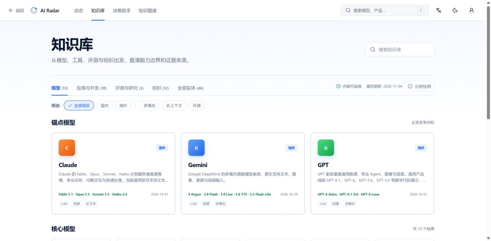
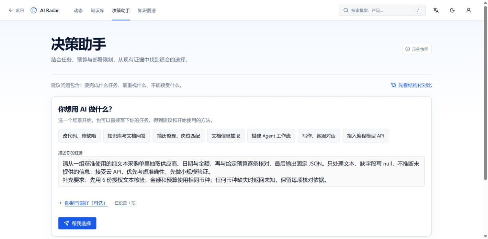
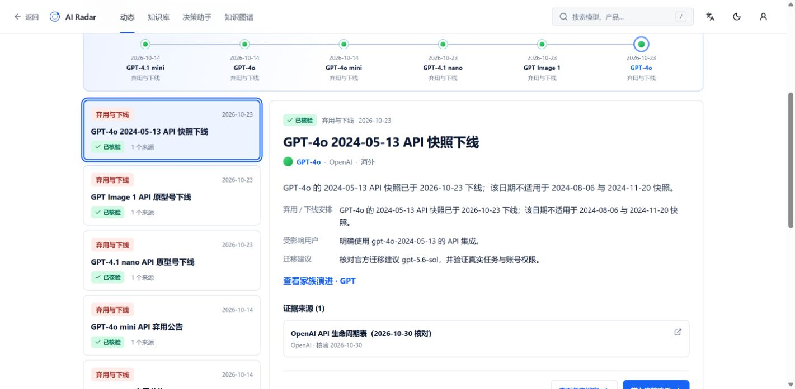
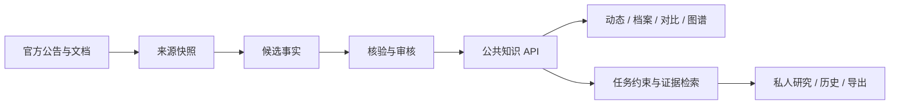

<div align="center">


# AI Radar

**AI 模型与产品信息研究 · 个人实践项目**

把分散的模型资料、版本变化和使用条件，整理成有来源、可复查的选型研究。

[在线体验 ↗](https://ai-radar.xue-ai.workers.dev) · [产品案例](docs/portfolio/CASE_STUDY.md) · [验证记录](docs/portfolio/VALIDATION.md) · [本地运行](#本地运行)

[](https://github.com/xuerp/ai-knowledge-explorer/actions/workflows/quality.yml)
[](LICENSE)

</div>

> **项目状态**：可在线体验的预发布作品，采用人工维护、经审核的来源快照。动态按已收录事件展示，**不提供实时全量追踪**。公共资料可直接浏览；保存个人研究需要登录。

首页先渲染随版本附带的公开资料快照，随后自动同步后台已发布资料：打开时、切回页面、恢复联网以及停留期间每 5 分钟都会核对，无需重新发布前端。失败时保留当前内容并提示同步状态；资料更新日期与最近同步时间分开显示。预置快照仍由 `npm run generate:frontend-snapshot` 从同一份公开目录生成，CI 检查一致性。自动同步覆盖已收录、已发布内容；外部消息的采集与审核仍有独立边界。

[](https://ai-radar.xue-ai.workers.dev/knowledge)

_线上实拍 · 2026-11-05。截图展示当时的收录内容，事实适用范围以各条资料的日期和来源为准。_

## 解决什么问题

选模型时，知道一个名字只是开始。真正影响选择的是：具体哪个版本、能做什么、怎样接入、数据能否外传、预算是否允许，以及这些说法的依据在哪里。

AI Radar 面向需要评估 AI 方案的产品经理与开发者，把这段过程串起来：

**发现变化 → 查清版本 → 核对证据 → 带入任务约束 → 保存研究**

例如，为公司内部 PDF / Word 文档研究问答方案时，可以先查候选的部署与使用条件，再补充隐私、引用和预算要求，形成带依据与待验证条件的路线，并在条件改变后保存新版本。

## 我的工作

这是一个持续迭代的个人实践项目，围绕 AI 信息整理、知识组织和选型分析展开。我负责问题定义、产品流程、数据与证据规则、验收标准和迭代取舍，**以规格和验收标准驱动 AI 编程代理实现**，并通过实际页面、接口、数据和回归结果检查交付。

| 产品决策                           | 在项目中的落地                                                             |
| ---------------------------------- | -------------------------------------------------------------------------- |
| 将“查资料”衔接到“判断是否适合任务” | 动态、版本档案、对比与研究共享对象和证据；研究可以修改、保存和重开         |
| 区分对象、事实与证据               | Entity–Claim–Evidence 分层；一条事实可关联多个来源，型号和适用日期分别保留 |
| 控制生成内容的可信边界             | 抽取结果先进入候选；公开事实须经审核；缺失条件保留为未知                   |
| 让建议可以继续执行                 | 围绕任务、预算、隐私和部署条件筛选，提供理由、限制和下一步验证任务         |

设计过程、具体失败与修正见[产品案例](docs/portfolio/CASE_STUDY.md)。

## 体验三个核心场景

| 场景                   | 体验入口                                                | 重点观察                                                     |
| ---------------------- | ------------------------------------------------------- | ------------------------------------------------------------ |
| 理解一次模型变化       | [动态](https://ai-radar.xue-ai.workers.dev/updates)     | 事件类别、发生日期、具体型号、影响范围和证据入口             |
| 查清候选的能力边界     | [知识库](https://ai-radar.xue-ai.workers.dev/knowledge) | 家族与版本的区别、规格、来源、未知信息与条件对比             |
| 围绕自己的任务研究方案 | [决策助手](https://ai-radar.xue-ai.workers.dev/ask)     | 原页澄清、任务约束、候选依据、保存历史与 Markdown / PDF 导出 |

<details>
<summary>查看研究入口与事件追踪实拍</summary>

### 从任务与约束开始

[](https://ai-radar.xue-ai.workers.dev/ask)

### 从变化回到具体型号与证据

[](https://ai-radar.xue-ai.workers.dev/updates)

以上均为 2026-11-05 线上页面实拍。

</details>

## 关键设计与取舍

**让事实带着来源进入产品。** 模型输出固定为待审核候选，审核状态决定它能否进入公共知识；公开资料与个人研究通过不同接口读取。[候选与事实分离](docs/adr/0003-candidate-verified-claim-separation.md)

**把版本和时间作为判断条件。** 某个 API 快照下线，只影响具名接口与适用范围。事件类型同时检查结构化事实和时间线，避免标题写“下线”、标签却写“开放”。[事件分类实现](backend/app/catalog_changes.py)

**围绕实际限制组织建议。** 先识别任务与必要条件，再检索和筛选；未知价格不会被当作免费，未执行的试用不会被写成模型成绩。[决策助手验收合同](docs/DECISION_PRODUCT_ACCEPTANCE.md)

**把错误与过期数据显式呈现。** API 模式发生错误时保留错误；离线目录是独立运行方式，避免用旧示例伪装最新返回。[数据访问边界](docs/adr/0007-domain-routers-and-public-snapshot-boundary.md)

## 实现与架构



图示为系统设计；持续采集到前台更新的线上运行闭环仍待验收。

| 层次       | 技术与职责                                                                 |
| ---------- | -------------------------------------------------------------------------- |
| 前端       | React 19、TypeScript、TanStack Start / Query、Tailwind CSS                 |
| 服务端     | FastAPI、Pydantic、SQLAlchemy、Alembic；知识查询、账户、审核与研究接口     |
| 数据与检索 | PostgreSQL / SQLite；结构化事实、词法检索与可配置混合检索                  |
| 部署与检查 | Cloudflare Workers、Render、GitHub Actions；回归、构建与线上版本一致性检查 |

[系统架构](docs/ARCHITECTURE.md) · [架构决策](docs/adr/) · [文档索引](docs/README.md)

## 已验证什么，还有什么没完成

- **已执行的软件与页面检查**：公共资料浏览、筛选、跨页对比；研究新建、修改保存、历史重开、澄清和报告导出；事件类别与支撑事实的一致性回归。
- **内容与评估范围**：收录资料保留来源和日期；固定快照的检索评测单独记录，不能当作当前线上准确率。
- **仍待验证**：持续采集、抽取、审核发布与前台更新的运行闭环；独立内容复核、真实目标用户测试、业务样本效果与邮件实际送达。

当前决策建议主要由检索、约束筛选与预设工作流组织。可选模型需求解析与后台候选抽取分别配置，不等于已经提供大模型个性化方案生成。

本项目尚无用户增长、成本节省或业务效果的实测结论。[验证记录与证据边界](docs/portfolio/VALIDATION.md) · [固定评测](docs/eval/CHANGELOG.md)

## 本地运行

前端需要 Node.js 22 与 Bun 1.4.3：

```bash
git clone https://github.com/xuerp/ai-knowledge-explorer.git
cd ai-knowledge-explorer
bun install --frozen-lockfile
bun run dev
```

未配置 API 时使用内置目录，可浏览知识与界面。登录、研究持久化和后台维护需要后端。

后端使用 Python 3.12，按[后端启动指南](backend/README.md#本地启动)安装依赖并执行迁移。在项目根目录 `.env.local` 中连接 API：

```dotenv
VITE_API_BASE_URL=http://127.0.0.1:8000
VITE_API_UPSTREAM_URL=http://127.0.0.1:8000
```

重启前端，并确认后端 CORS 允许前端地址。模型抽取、可选需求解析及邮件服务按需单独配置。[部署说明](docs/STAGING_DEPLOYMENT.md)

<details>
<summary>项目结构与检查命令</summary>

```text
src/                  页面、交互、领域模型与 API 访问
backend/app/          知识、研究、采集与审核服务
backend/data/         数据源、规则与固定输入
backend/migrations/   数据库迁移
backend/tests/        后端回归
tests/                前端与跨层契约检查
product/              共享产品配置与状态
scripts/              构建、生成、检查与维护工具
ops/                  调度与部署配置
docs/                 产品案例、架构、运行指南与评测
```

```bash
bun run check
cd backend
python -m pytest tests
```

测试所需环境见[后端测试说明](backend/tests/README.md)。

</details>

## 反馈与许可

[提交问题](https://github.com/xuerp/ai-knowledge-explorer/issues)时，请提供页面、操作步骤、预期与实际表现；纠正资料请附具体对象和原始来源。安全问题见 [SECURITY.md](SECURITY.md)。

[MIT License](LICENSE)
