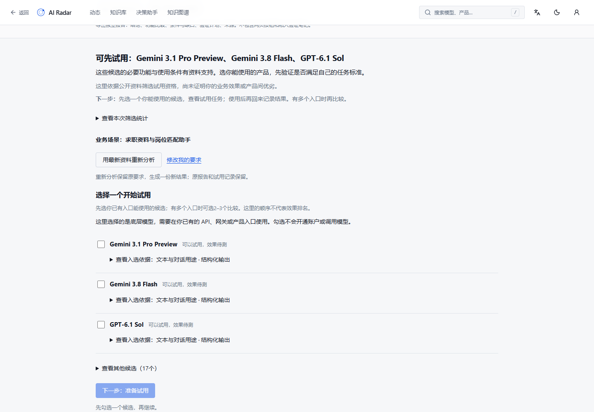
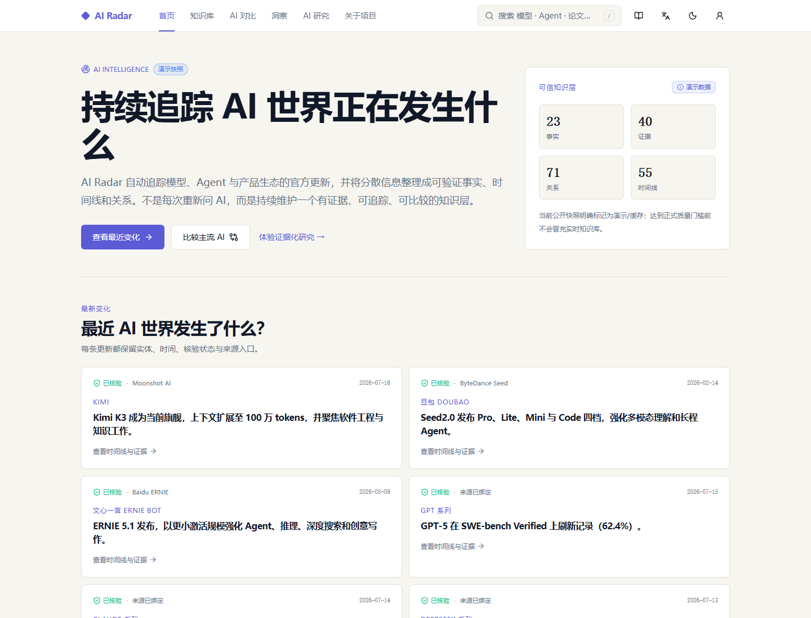

# AI Radar

> 基于可验证的最新信息理解 AI 变化，并做出模型与产品选择。

[在线体验](https://ai-radar-staging.1966761779.workers.dev) · [数据质量](https://ai-radar-staging.1966761779.workers.dev/quality) · [产品 Case Study](https://ai-radar-staging.1966761779.workers.dev/case-study) · [架构说明](docs/ARCHITECTURE.md)

## 当前版本与使用入口

- 固定公网入口：[决策助手](https://ai-radar-staging.1966761779.workers.dev/ask)。这是预发布环境，仍明确标记为 `demo`，不等于正式生产数据或全市场证据已补齐。
- 本地开发页面依赖本机前后端进程，`127.0.0.1` 地址不能用于其他设备或长期在线访问。公网前端、API 与数据库独立托管，不依赖开发电脑开机。
- [发布与恢复说明](docs/STAGING_DEPLOYMENT.md)、[最新同步记录](docs/RELEASE_SYNC_20261014.md)、[决策助手完成标准](docs/DECISION_PRODUCT_ACCEPTANCE.md)。部署是否完成以公网前后端的精确版本及迁移检查为准。

决策助手先给出有依据的候选与限制。选择自己能使用的一个候选，点击“下一步：准备试用”，拿到任务与验收要求；在现有产品入口执行后，回来记录真实结果。其他候选的资料维护和筛选审计是次级路径。没有候选满足必要条件时，会显示实际阻断项。

目前没有集成通用模型账户连接与自动业务评测。候选顺序不是性能排名，保存计划不会生成测试成绩，私人试用记录不会自动变为公开事实。当前支持范围与资料缺口见[产品验收标准](docs/DECISION_PRODUCT_ACCEPTANCE.md)。





## 为什么需要 AI Radar

通用 AI Chat 适合一次性研究，但长期追踪几十个模型、Agent 和框架时，用户仍要重复搜索、核验来源、整理历史和重建比较维度。AI Radar 把这些重复工作沉淀为持续维护的知识层。

| 通用 AI Chat        | AI Radar                           |
| ------------------- | ---------------------------------- |
| 每次重新提问        | 持续维护实体状态                   |
| 一次性生成          | Claim、Timeline、Relation 长期沉淀 |
| 来源附属于回答      | Evidence 是一级数据                |
| 对比依赖临时 Prompt | 固定维度下长期 Compare             |
| 模型直接组织结论    | Candidate 经过验证后才能公开       |
| 内容不足时可能补全  | 证据不足时明确拒答                 |

## 产品闭环

### 1. 追踪器：发现哪些变化值得关注

首页和 Timeline 提供高频入口，持续记录主流模型的关键更新、版本演进和信息时点。

### 2. 决策助手：把变化转化为选择

用户提供任务、优先级、预算和部署限制；系统结合当前版本、历史变化、固定比较维度与 Evidence，给出有条件的建议。Compare 是该流程中的结构化分析工具。

### 3. 知识基础设施：解释为什么

知识库、Relation、Graph 和 Evidence 共同维护模型谱系、竞品、生态与来源。实体页先展示可读关系，完整图谱作为二级高级探索页保留。

阅读模式不生成三套事实：通俗模式突出发生了什么和用户影响，产品模式突出场景、竞品和商业变化，技术模式突出规格、API、Benchmark、限制与原始 Evidence。

### 4. 可信 RAG：先检索可核验事实，再生成回答

当前研究链路已经具备 PostgreSQL 全文检索、逐条 Claim 引用、Evidence 校验、检索诊断和黄金问题评估。默认配置仍保持零额外模型费用的 `lexical + extractive` 模式；staging 在明确预算上限内使用 Cloudflare Workers AI `@cf/baai/bge-m3` 做 Hybrid 检索，并在 provider 异常时安全降级到 lexical。

固定 Golden Set v1.0.0 的 80 条查询中，生产 Hybrid 路径真实达到 Recall@8 100.00%、Precision@8 14.22%、Entity Recall@8 98.75% 和通过率 100.00%。Precision@8 固定以 8 为分母，且多数题只标注一个相关 Claim，因此不据此无证据引入 Reranker。项目不会用“能生成回答”替代真实召回质量。

## 工作方式

```text
官方信源
  ↓
安全采集 → Snapshot / Diff
  ↓
LLM 结构化抽取
  ↓
Candidate
  ↓
Evidence Anchor + Schema Validation
  ↓
语义去重 + 冲突检测 + 风险分级
  ↓
人工审核
  ↓
Verified Claim
  ↓
Tracker / Decision Assistant / Knowledge
```

LLM 在系统中是“提议者”，不是“事实裁决者”。模型输出不能直接进入公开知识库。

## AI 可信与产品决策

- **Candidate / Verified Claim 分离：** 明确区分模型生成和系统认可。
- **证据锚点：** 除来源链接外，保存支持结论的原文片段。
- **结构化降级但不降标准：** 供应商不兼容 JSON Schema 时可使用 `json_object`，仍执行严格字段校验。
- **语义去重与冲突保护：** 阻止同义重复、有效期重叠和相互矛盾内容静默发布。
- **风险分级审核：** 当前所有自动抽取结果都进入人工审核；未来是否允许低风险自动批准必须另行授权并由真实精度证明，价格、Benchmark、安全事件和冲突始终保留人工审核。
- **Showcase / Live 分离：** 作品集使用明确标记的精选快照；正式模式继续受 Claim、关系、黄金问题和生产就绪门槛约束。

完整决策说明见[产品 Case Study 文档](docs/PORTFOLIO_CASE_STUDY.md)和[简历与面试材料](docs/RESUME_AND_INTERVIEW.md)。

## 当前公开状态

- 前端：Cloudflare Workers
- API：Render FastAPI
- 数据库：Neon PostgreSQL
- 定时任务：Cloudflare Cron 为主调度；GitHub Actions 仅保留手动应急回退
- 环境：公网预发布；后端运行配置为 `production`，不代表正式数据验收通过
- 数据模式：`demo`
- 快照新鲜度：`cached`

2026-10-14 本轮发布资料在独立空数据库核对为 261 个实体、316 条公开事实、532 条来源，事实和来源与本地已审核公开接口逐项一致。公网是否已经运行该版本，以发布记录中的精确 commit 和部署后核对为准。事实数量不等于正式验收；冲突、过期和资料缺项仍受各自门槛约束，保持 `demo`。普通自动抽取默认关闭，新调用不继承历史预算或授权。

## 主要入口

| 路径                   | 用途                                               |
| ---------------------- | -------------------------------------------------- |
| `/`                    | 变化追踪、8 个核心模型和产品决策入口               |
| `/knowledge`           | 分类浏览实体知识库                                 |
| `/knowledge/model/gpt` | GPT 系列档案、版本和时间线                         |
| `/ask`                 | 核心决策助手；公开预置问题与登录后私密研究         |
| `/compare`             | 决策流程中的结构化路线与具体版本比较               |
| `/graph`               | 从实体页进入的二级关系网络、路径与来源探索         |
| `/quality`             | 业务数据质量与固定集检索评估；分别显示独立更新时间 |
| `/case-study`          | 正式公开产品故事、决策、风险和取舍                 |
| `/admin/review-demo`   | 无需登录的只读审核闭环                             |
| `/admin/review`        | 真实 reviewer/admin 工作台                         |

## 技术架构

- 前端：React、TypeScript、TanStack Router/Start、Tailwind CSS、PWA。
- 后端：FastAPI、Pydantic、SQLAlchemy、Alembic、JWT/RBAC。
- 数据：PostgreSQL；本地和 CI 同时保护 SQLite/PostgreSQL 迁移兼容。
- 部署：Cloudflare Workers 同域代理 → Render API → Neon PostgreSQL。
- 自动化：安全采集、租约、退避、OpenAI-compatible 抽取、审核、通知 Outbox、Cloudflare Cron 与 GitHub Actions 手动回退。
- RAG：PostgreSQL 全文检索、GIN 投影索引、逐 Claim 引用、严格生成 Schema、失败降级与黄金问题评估。
- 质量：ESLint、TypeScript、前后端自动测试、Ruff、生产构建、SQLite/PostgreSQL 迁移验证、固定集检索评估和数据质量门槛。

详细结构见[架构说明](docs/ARCHITECTURE.md)。

## 本地运行

前端要求 Node.js 22 和 Bun 1.4.3：

```bash
bun install --frozen-lockfile
bun run dev
```

依赖以 `package.json` 指定的 Bun 和唯一 `bun.lock` 为准；不要另行生成 npm/pnpm 锁文件。可运行 `bun audit --audit-level low` 核查已解析依赖，CI 同样执行该检查。

后端：

```powershell
cd backend
python -m venv .venv
.\.venv\Scripts\python.exe -m pip install -r requirements.txt
Copy-Item .env.example .env
.\.venv\Scripts\python.exe -m alembic upgrade head
.\.venv\Scripts\python.exe -m uvicorn app.main:app --reload --port 8000 --env-file .env
```

前端 `.env`：

```text
VITE_API_BASE_URL=http://127.0.0.1:8000
```

不配置 API 时，公开产品使用明确标记的内置演示快照；配置后如果 API 暂时不可用，首屏和预置研究会显式说明正在使用该快照，不会冒充实时结果。

## 质量检查

```bash
bun install --frozen-lockfile
node scripts/export-demo-snapshot.mjs
bun run check
bun run prepare:cloudflare:staging
cd backend
python -m ruff format --check app tests migrations
python -m ruff check app tests migrations
python -m compileall -q app tests migrations
python -m pytest
python -m alembic upgrade head
python -m alembic current --check-heads
python -m alembic check
```

项目采用风险测试：日常改动执行针对性检查，Epic 完成执行完整回归，发布时再执行匿名浏览器与线上关键路径验收。

## 安全与负责任披露

- 真实 `.env`、数据库连接串、模型 Key、JWT Secret、SMTP 密码和云平台 Token 不进入 Git。
- Render 与 Cloudflare 只通过平台 Secret 注入凭据，前端变量不得保存敏感信息。
- 管理员初始化完成后移除静态 bootstrap Token，日常管理使用短期 JWT 与 RBAC。
- 安全问题请按照[安全策略](SECURITY.md)私密报告，不要在公开 Issue 中提交凭据或漏洞细节。

## 路线与边界

### Portfolio v1

- 收敛首页、Timeline、Compare、Research、Evidence 与 Case Study。
- 完成 README、截图、演示脚本、简历和面试材料。
- 不降低正式数据门槛。

### v1.5 Live Ready

- 只在真实新增官方 Evidence 支持时处理资料缺口，不把历史计数或覆盖差值当作强制 KPI。
- 运行黄金问题、数据质量和生产就绪检查。
- 完成 SMTP、正式域名、外部监控和备份恢复演练。
- 只有 `liveReady=true` 后才把 `AI_RADAR_DATA_MODE` 改为 `live`。

## 项目资料

- [文档索引与权威层级](docs/README.md)
- [当前完成规格](docs/PROJECT_COMPLETION_SPEC.md)
- [Spec v2 执行记录](docs/AI_RADAR_IMPROVEMENT_SPEC_V2_EXECUTION.md)
- [当前产品诊断](docs/PRODUCT_DIAGNOSIS_AND_IMPROVEMENT.md)
- [作品集验收与截图](docs/PORTFOLIO_ACCEPTANCE.md)
- [3 分钟演示与短视频脚本](docs/DEMO_SCRIPT.md)
- [产品 Case Study 文档](docs/PORTFOLIO_CASE_STUDY.md)
- [简历与面试材料](docs/RESUME_AND_INTERVIEW.md)
- [生产运行手册](docs/PRODUCTION_RUNBOOK.md)

## 开源许可

项目采用 [MIT License](LICENSE)。允许学习、使用、修改和分发，但必须保留原始版权与许可声明。
