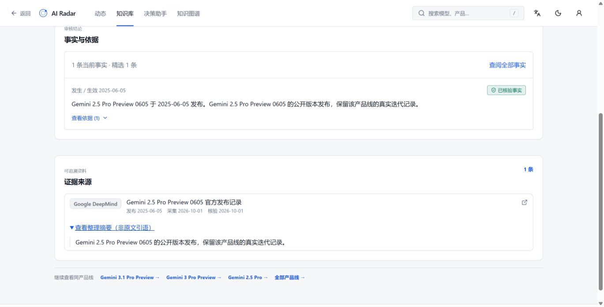

# AI Radar

**查 AI 动态，看原始依据，留下自己的选型研究。**

AI 模型更新很快，但做选择时真正需要的信息往往分散在公告、文档和模型卡里：这个能力属于哪个版本？有什么使用限制？一条结论来自哪里？

AI Radar 是一个 AI 技术研究工作台。你可以从一条动态进入模型档案，核对版本、能力和来源，再带着自己的任务进入决策助手，将研究保存为可继续修改的报告。

[快速开始](#快速开始) · [使用流程](#怎么使用) · [架构说明](docs/ARCHITECTURE.md) · [数据与验证记录](docs/portfolio/VALIDATION.md)


## 能做什么

- **追踪变化**：按时间、对象和核验状态筛选动态，沿关联进入具体模型或产品。
- **查清版本与条件**：在知识库中查看模型家族、版本、能力描述及原始资料，通过对比页核对差异。
- **带着任务研究**：描述用途和约束，查看候选、证据与限制；登录后保存、修改、重开研究，导出 Markdown 或 PDF。
- **探索关系**：通过知识图谱查看开发者、模型、应用之间的关联，回到对应档案继续查证。
- **维护知识**：采集资料先进入候选队列，审核后发布到公共知识；个人研究与公共资料分开保存。

## 怎么使用

假设你正在为文档处理功能选择模型，需要先确认输入格式、上下文限制和部署条件：

1. 在**知识库**搜索模型，进入具体版本，查看能力说明和证据。
2. 打开**原始来源**，核对条件和日期；需要比较时，把候选放入对比页。
3. 在**决策助手**描述任务，例如“处理内部文档，需要保留引用，并满足本地部署要求”。这是需求输入示例，不是预设推荐结果。
4. 查看研究中的依据和限制，登录后保存。后续可以修改条件、重开历史记录或导出报告。

证据不足时，研究会保留缺口。文档写明的能力与模型在你实际任务中的效果，需要分别判断。

<details>
<summary>查看来源如何呈现</summary>



来源文本分为原文引语、整理摘要和未分类文本。整理后的描述不会自动当作原文引用。

</details>

## 快速开始

开发环境：Node.js 22、Bun 1.4.3；运行后端需要 Python 3.12。

```bash
git clone https://github.com/xuerp/ai-knowledge-explorer.git
cd ai-knowledge-explorer
bun install --frozen-lockfile
bun run dev
```

打开终端打印的本地地址。未配置 API 时，前端读取仓库内置快照，可浏览界面与目录；账户、研究持久化和维护功能需要后端。内置快照包含历史与示例内容，不是实时数据服务。

### 连接后端

按[后端启动指南](backend/README.md#本地启动)安装依赖、配置数据库并执行迁移。然后在项目根目录的 `.env.local` 中设置：

```dotenv
VITE_API_BASE_URL=http://127.0.0.1:8000
VITE_API_UPSTREAM_URL=http://127.0.0.1:8000
```

重启前端开发服务。第一个地址用于浏览器请求，第二个用于服务端渲染；后端 CORS 配置需允许你的前端地址。

- API 文档：后端启动后访问 `http://127.0.0.1:8000/docs`。
- 模型生成、自动采集和邮件分别配置，详见[后端说明](backend/README.md)。
- [预发布网站](https://ai-radar-staging.1966761779.workers.dev)展示已部署版本，可能落后于仓库代码。

## 数据从哪里来

知识目录保存官方公告、文档、模型卡等来源，并记录事实对应的对象、日期与审核状态。系统将三个部分分开：

| 数据     | 含义               | 示例                                 |
| -------- | ------------------ | ------------------------------------ |
| Entity   | 被研究的对象       | 模型家族、具体版本、应用、组织       |
| Claim    | 关于对象的一条事实 | 支持的输入类型、发布阶段、使用条件   |
| Evidence | 支撑事实的资料     | 来源链接、摘录或摘要、采集与核验信息 |

采集与模型抽取产生的是候选资料，经审核才能进入公共知识。来源数量不作为能力排名；未知价格不视为免费；历史公告与当前状态分别核对。

**当前仍在进行全量来源语义、时效和生命周期复核。** 本地研究主流程已有复验记录，持续更新闭环、邮件实际送达和当前版本线上全流程验收尚未完成。详细进度见[验证记录](docs/portfolio/VALIDATION.md)。

## 如何实现

**React + TypeScript + TanStack · FastAPI + Pydantic · SQLAlchemy + Alembic**

```text
官方资料 → 采集快照 → 候选抽取 → 审核发布
                                 ↓
                        Entity / Claim / Evidence
                                 ↓
              动态 · 知识库 · 版本对比 · 知识图谱
                                 ↓
                     任务研究 → 保存历史 → 导出报告
```

- 前端通过共享数据访问层连接目录、研究与账户 API。
- 后端处理权限、审核与知识查询，SQLite 用于本地开发，PostgreSQL 用于部署。
- 检索与生成分离，研究保留引用及证据不足状态。
- 公共知识与个人研究分开管理，候选发布有审核和历史记录。

```text
src/routes/          页面与路由
src/components/      共享界面及研究组件
src/services/        前端数据访问
backend/app/         API、知识查询、采集与研究逻辑
backend/migrations/  数据库迁移
backend/tests/       后端测试
tests/               前端与数据契约测试
docs/                架构、运行及验证文档
```

## 开发与检查

```bash
bun run typecheck
bun run test
bun run build
```

后端测试在安装依赖后运行：

```bash
cd backend
python -m pytest tests
```

完整项目检查使用 `bun run check`。部署相关测试可能需要额外环境配置；测试通过与外部服务实际可用分别验证。

[产品流程与设计](docs/portfolio/CASE_STUDY.md) · [运行指南](docs/portfolio/WALKTHROUGH.md) · [架构决策](docs/adr) · [文档索引](docs/README.md)

## License

[MIT](LICENSE)
