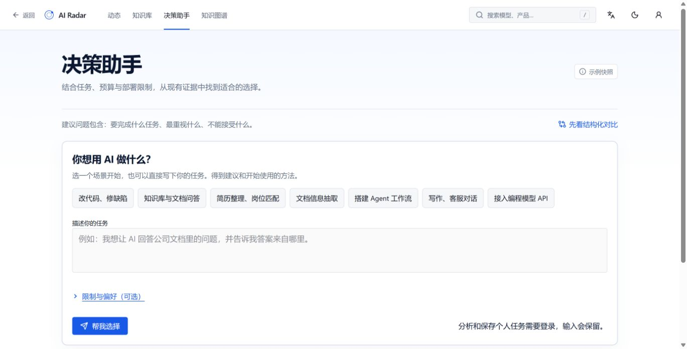

<div align="center">

# AI Radar

### 让 AI 技术选型有据可查

从官方资料到结构化事实，再到可追溯的研究结论。

**React · TypeScript · TanStack · FastAPI · SQLAlchemy**

[项目案例](docs/portfolio/CASE_STUDY.md) · [运行与演示](docs/portfolio/WALKTHROUGH.md) · [数据与验证边界](docs/portfolio/VALIDATION.md) · [简历与面试](docs/portfolio/RESUME.md)

</div>

---

AI 工具的介绍容易找到，适用条件、信息时点与证据却常常散落各处。**AI Radar 是一个面向 AI 技术研究与选型的全栈项目**：将实体、事实和来源分开管理，让用户查清“这个判断依据什么”，再决定下一步。

项目的重点是证据建模、审核边界和跨页面研究流程。产品保留动态、知识库、模型家族、决策助手与知识图谱的完整流程。项目介绍不以缩小数据范围代替质量整改，也不编造测评成绩、用户试用结果或商业效果。



## 一眼看懂项目

| 用户任务             | 产品能力                       | 工程实现                                |
| -------------------- | ------------------------------ | --------------------------------------- |
| 了解一个工具能做什么 | 搜索知识库、查看实体与能力要点 | Entity 与 Claim 分离，事实关联 Evidence |
| 核对判断是否可信     | 查看原文摘录、来源和日期       | 官方文档固定版本、来源引用、数据状态    |
| 带着具体需求研究     | 输入需求，查看证据与限制       | 检索、结构化回答、证据不足状态          |
| 留下研究过程         | 保存研究、查看历史与报告       | 账户、持久化 API、报告路由              |
| 维护公共知识         | 候选审核后发布                 | Candidate / Claim 分层、审核 API 与迁移 |

上表描述代码中的功能结构，不代表所有功能均已通过当前版本的端到端验收。[验证记录](docs/portfolio/VALIDATION.md)列明当前证据和缺口。

本地已完成一次从登录、提交需求、保存与修改研究，到打开报告、下载 Markdown/PDF 的[浏览器流程复验](docs/portfolio/WORKFLOW_VERIFICATION_20261026.md)。全量来源语义核实尚未通过，功能复验不替代数据准确性验证。

## 运行完整项目

需要 Node.js 22、Bun 1.4.3 和 Python 3.12。

```bash
git clone https://github.com/xuerp/ai-knowledge-explorer.git
cd ai-knowledge-explorer
bun install --frozen-lockfile
bun run dev
```

未配置 API 时，前端使用原有完整目录快照；这适合查看页面结构，不应将历史快照当成实时事实。需要后端研究、账户与持久化功能时，按[后端启动指南](backend/README.md#本地启动)启动服务，并在前端配置：

```dotenv
VITE_API_BASE_URL=http://127.0.0.1:8000
VITE_API_UPSTREAM_URL=http://127.0.0.1:8000
```

使用现有数据库继续开发时保留原数据，避免用演示种子覆盖已审核记录。模型调用、自动采集与邮件投递按各自配置启用。

[预发布网站](https://ai-radar-staging.1966761779.workers.dev)用于查看已部署版本；本地修改和 GitHub main 更新不等于网站已部署相同版本。

## 数据可信度

本轮保留完整目录，并修复来源 URL、发布阶段和视频输入条件，公开页面移除预置用户活动。[2026-10-26 核实记录](docs/portfolio/CATALOG_VERIFICATION_20261026.md)提供逐条来源检查与剩余缺口；当前不能宣称全部事实已重新核验。

项目保留完整内容范围，按来源、时间和审核状态逐项核实。已审核事实、历史快照、待核实资料与用户试用结果应明确区分；缺少证据时不编造结论。

资料引用数量不是独立信源数量，官方能力描述也不等于实际任务效果。历史评测只适用于原语料和版本，不能直接作为当前准确率。

来源文本区分原文引语、整理摘要和未分类文本；未分类内容不会自动冒充原文。[引用标注与历史记录复核](docs/portfolio/SOURCE_TEXT_VERIFICATION_20261027.md)记录修复及验证边界。

仓库保留一份[官方来源校验样本](docs/portfolio/real-data/README.md)，用于解释版本固定、摘录和 SHA-256 校验；它不再作为应用数据源或推荐运行入口。恢复完整目录也不表示其中所有事实都已重新核验。

## 架构与关键取舍

| 层次             | 职责                           | 代码入口                                                 |
| ---------------- | ------------------------------ | -------------------------------------------------------- |
| React / TanStack | 路由、知识库、研究与报告       | [`src/routes`](src/routes)                               |
| API 客户端       | 数据访问与用户操作             | [`src/services`](src/services)                           |
| FastAPI          | 请求校验、权限与业务接口       | [`backend/app/main.py`](backend/app/main.py)             |
| 知识层           | Entity、Claim、Evidence 与快照 | [`backend/app/repository.py`](backend/app/repository.py) |
| 数据持久化       | SQLAlchemy 与数据库迁移        | [`backend/migrations`](backend/migrations)               |

- **事实与推断分开**：来源是独立对象，候选内容不能直接等同于已审核事实。
- **检索先于生成**：检索与生成分离，便于检查证据链和定位失败。
- **未知保持未知**：没有实测结果时，不将文档能力包装成性能结论。
- **完整范围逐项核实**：保留产品内容与流程，依据来源和时间推进数据质量整改。

详细设计见[架构文档](docs/ARCHITECTURE.md)和[架构决策记录](docs/adr)。历史评测仅适用于原记录的版本与语料，不作为当前成绩。

## 项目边界

当前交付目标是可复现、可解释的作品集项目。实时全市场覆盖、长期无人值守采集、跨供应商真实模型评测和生产稳定性，不在本次已验证能力之内。当前完整产品的浏览器验收和数据复核仍需完成，详见[验证记录](docs/portfolio/VALIDATION.md)。

没有宣称用户增长、节省成本、生产 SLA 或不存在的准确率。用于简历时，请按实际参与范围描述个人职责。

## 继续阅读

- [项目案例](docs/portfolio/CASE_STUDY.md) · [演示路线](docs/portfolio/WALKTHROUGH.md)
- [简历与面试](docs/portfolio/RESUME.md) · [完整文档索引](docs/README.md)
- [后端说明](backend/README.md) · [MIT License](LICENSE)

<!-- delivery-status:start -->
## 当前项目进度

记录更新：2026-10-27。完整项目保留，作品集验收进行中。

以下是项目验收记录，不是当前网站的实时健康状态。代码更新、本地验证与线上部署分别记录。

- **动态、知识库、家族与图谱**：完整浏览、筛选和关联入口保留。 基础浏览与部分跨页操作已测；同版全流程复验未完成。

- **决策研究与导出**：登录、研究保存、修改、历史及报告导出。 本地主流程、桌面/手机报告及 PDF 已复验；不代表所有选型场景通过。

- **数据与来源**：事实与证据分离，原文、摘要和未分类文本区分。 部分链接、条件与引用标记已修复；全量语义、时效与生命周期复核未完成。

- **采集、审核与通知**：采集、候选审核、发布与通知模块保留。 已有软件回归；持续更新闭环及邮件实际送达尚未验收。

- **项目展示与部署**：README、项目介绍、简历材料和验证记录。 修复已分批更新 GitHub；尚未部署到展示网站并完成线上复验。

统一来源：`product/delivery-status.json`。修改后运行 `npm run sync:delivery-status`；检查命令会阻止各入口进度漂移。
<!-- delivery-status:end -->
