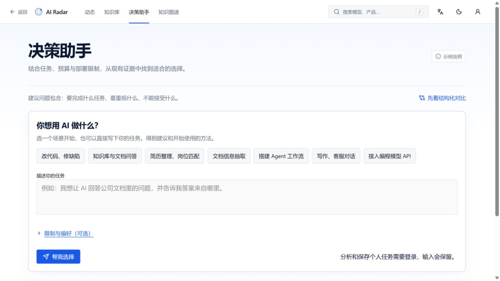
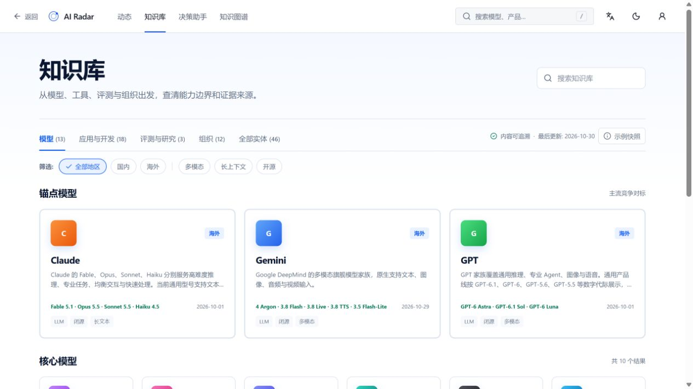
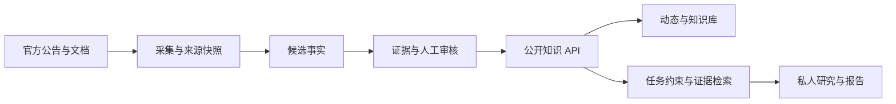

<div align="center">


# AI Radar

### 从模型变化到技术选型，让每一步都有依据。

追踪动态 · 查阅知识 · 对比版本 · 开展研究 · 保存报告

**[打开网站 ↗](https://ai-radar.xue-ai.workers.dev)** · [功能预览](#功能预览) · [本地运行](#本地运行) · [技术架构](#技术架构) · [反馈问题](https://github.com/xuerp/ai-knowledge-explorer/issues)

React / TypeScript / TanStack · FastAPI / SQLAlchemy · MIT

[](https://github.com/xuerp/ai-knowledge-explorer/actions/workflows/quality.yml)

</div>

> 当前网站为预发布版本。你可以直接浏览动态与知识库；个人研究和保存需要登录。线上版本、数据模式与验证范围见[项目状态](#项目状态)。

## 快速了解

1. [打开网站](https://ai-radar.xue-ai.workers.dev)，从动态进入一个具体版本，沿证据入口核对原始资料。
2. [体验决策助手](https://ai-radar.xue-ai.workers.dev/ask)，输入自己的任务和限制，查看候选、依据及下一步；个人研究需要登录。
3. 查看下方[技术架构](#技术架构)与[三个实现取舍](#三个实现取舍)，了解公开事实、私人研究和模型候选如何分开。

## 为什么做 AI Radar

“这个模型更新了什么？”和“它适不适合我的任务？”之间，还隔着版本、能力、价格、部署条件和证据。

AI Radar 把分散的公告、模型卡和技术文档整理成关联的知识目录。你可以从一条动态进入模型档案，沿来源核对说法，再结合自己的任务研究候选方案，把判断和依据一起留下来。

它适合需要跟进 AI 技术的开发者、研究者，以及正在比较模型和应用方案的产品团队。

## 从这里开始

| 你想做什么                   | 打开哪里                                                | 可以继续做什么                     |
| ---------------------------- | ------------------------------------------------------- | ---------------------------------- |
| 看模型与产品发生了什么变化   | [动态雷达](https://ai-radar.xue-ai.workers.dev/updates) | 按时间和对象筛选，进入相关档案     |
| 查一个模型的版本、能力和限制 | [知识库](https://ai-radar.xue-ai.workers.dev/knowledge) | 查看家族、具体版本、事实和来源     |
| 对照候选的差异               | [模型对比](https://ai-radar.xue-ai.workers.dev/compare) | 从知识库添加对象，核对规格与条件   |
| 带着任务研究该怎么选         | [决策助手](https://ai-radar.xue-ai.workers.dev/ask)     | 描述约束，查看候选与依据，保存研究 |
| 理解模型、应用与开发者的联系 | [知识图谱](https://ai-radar.xue-ai.workers.dev/graph)   | 沿关系探索，返回对象和原始资料     |

### 一条完整的研究路线

**发现变化 → 查阅档案 → 核对来源 → 比较条件 → 保存研究**

例如，你准备为内部文档建立问答功能：

1. 从知识库查看相关模型和平台，确认输入格式、部署方式与使用限制。
2. 打开具体事实的来源，区分官方原文、整理摘要和未知条件。
3. 在决策助手中描述“处理哪些文档、是否需要引用、数据能否上传、预算范围”。
4. 查看候选方案及其依据；登录后保存研究，修改条件时保留历史，按需导出 Markdown 或 PDF。

这是一条使用路线，不是预设推荐结果。实际候选取决于任务与当前证据；模型在业务样本上的表现仍需实测。

## 功能预览

以下为 **2026-10-31 新网址实拍**。图片保留浏览器返回的原始 JPEG 和尺寸，未二次压缩，可点击查看原图；功能入口均可在网站打开。

### 把任务和约束放在一起

先描述要完成的工作，再补充预算、部署方式和偏好。研究围绕这些条件展开。

[](docs/assets/portfolio/decision-entry-online-20261031.jpg)

### 从事实回到资料

模型档案保留版本、日期和来源入口；整理摘要与原文引语分别标注。历史记录注明适用日期，缺少原文的判断保留为待核实。

[](docs/assets/portfolio/knowledge-online-20261031.jpg)

[打开具体模型档案，查看「证据链」↗](https://ai-radar.xue-ai.workers.dev/knowledge/model/gemini-4)

### 把研究留下来

登录后可以保存、修改和重开研究，导出 Markdown 或 PDF。相关浏览器操作与导出验证见[研究流程记录](docs/portfolio/WORKFLOW_VERIFICATION_20261029.md)。

## 项目状态

**当前处于内测与整体验收阶段。** 动态、知识库、家族版本、对比、图谱、研究与维护端均已有实现，新网址上的登录、研究、修改、重开和报告下载已有浏览器验证；固定快照的 489 条事实记录已逐项比对来源；持续时效、缺证关系和真实用户测试仍待完成。

- **在线版本**：前后端已统一从 `main` 发布到新网址。当前构建可查看[前端版本](https://ai-radar.xue-ai.workers.dev/version.txt)和[后端就绪信息](https://ai-radar.xue-ai.workers.dev/backend/ready)；免费后端首次唤醒可能较慢。
- **数据状态**：当前部署定位为「证据审核流水线 + 人工维护的知识快照」，API 标记为 `demo` / `cached`。采集、抽取与审核模块保留；自动抽取默认关闭；已比对固定快照的事实来源，未知日期和缺证关系继续如实标注。公共结论需逐项审核后发布，持续实时追踪尚未验收。
- **待完成**：独立内容复核与持续时效维护、5 位目标用户实测、更多选型场景、持续采集到审核发布的闭环，以及邮件实际送达。

完整依据见[研究流程复验](docs/portfolio/WORKFLOW_VERIFICATION_20261029.md)与[验证记录](docs/portfolio/VALIDATION.md)。

## 本地运行

### 1. 启动前端

准备 Node.js 22 和 Bun 1.4.3：

```bash
git clone https://github.com/xuerp/ai-knowledge-explorer.git
cd ai-knowledge-explorer
bun install --frozen-lockfile
bun run dev
```

打开终端打印的地址。未配置 API 时使用内置快照，可以浏览界面与目录；账户和研究持久化需要后端。

### 2. 连接 API

后端使用 Python 3.12。按照[后端启动指南](backend/README.md#本地启动)安装依赖、配置数据库并执行迁移，然后在项目根目录 `.env.local` 中设置：

```dotenv
VITE_API_BASE_URL=http://127.0.0.1:8000
VITE_API_UPSTREAM_URL=http://127.0.0.1:8000
```

重启前端。后端 CORS 需允许你的前端地址；API 文档位于 `http://127.0.0.1:8000/docs`。

### 3. 按需启用服务

| 能力                 | 需要配置                           |
| -------------------- | ---------------------------------- |
| 浏览知识与动态       | 内置快照，或连接知识 API           |
| 登录、研究保存与历史 | 后端、数据库及账户配置             |
| 候选事实抽取         | 服务端抽取接口、模型及凭据         |
| 可选需求解析         | 独立模型配置、账户白名单与调用预算 |
| 自动采集、审核与通知 | 信源、worker 与审核权限            |
| 邮件摘要             | 邮件服务与投递配置                 |

具体环境变量和运行方式见[后端文档](backend/README.md)与[部署说明](docs/STAGING_DEPLOYMENT.md)。

当前决策助手通过资料检索、约束筛选和预设工作流组织操作建议，尚未接入大模型生成个性化操作方案。可选的模型需求解析仅负责识别任务与条件，与后台候选事实抽取分别配置；填写密钥不等于启用这些能力。

## 技术架构



| 层次     | 实现                                      | 主要职责                       |
| -------- | ----------------------------------------- | ------------------------------ |
| Web      | React、TypeScript、TanStack、Tailwind CSS | 路由、知识浏览、研究表单与报告 |
| API      | FastAPI、Pydantic                         | 查询、账户权限、审核与研究接口 |
| 数据     | SQLAlchemy、Alembic、SQLite / PostgreSQL  | 知识目录、个人记录与迁移       |
| 内容处理 | 采集快照、候选抽取、审核发布              | 将外部资料转为可追溯的公共知识 |

核心数据分为 **Entity（对象）— Claim（事实）— Evidence（证据）**。同一个模型可以有多条事实，一条事实可以关联多份资料；动态、模型档案、图谱和研究共享这层知识。

采集结果先进入候选审核，研究检索与建议组织分别处理。公共资料与个人研究分别保存，来源缺口、未知价格和未经实测的效果不会自动转换为确定结论。

<details>
<summary>查看项目结构与检查命令</summary>

```text
src/routes/          页面与路由
src/components/      共享界面及研究组件
src/services/        前端数据访问
backend/app/         API、采集、知识查询与研究逻辑
backend/migrations/  数据库迁移
backend/tests/       后端测试
tests/               前端与数据契约测试
docs/                架构、运行指南、当前验证与固定评测基线
```

```bash
bun run typecheck
bun run test
bun run build
# 完整项目检查
bun run check
# 后端安装依赖后
cd backend
python -m pytest tests
```

部署相关测试需要相应环境，测试结果与外部服务实际可用性分别验证。

</details>

历史实施与发布记录可从 Git 历史查询；运行回执不进入文档目录。

[架构说明](docs/ARCHITECTURE.md) · [设计决策](docs/adr) · [运行指南](docs/portfolio/WALKTHROUGH.md) · [文档索引](docs/README.md)

## 三个实现取舍

| 取舍                                               | 为什么这样做                                             | 实现入口                                                                                                                        |
| -------------------------------------------------- | -------------------------------------------------------- | ------------------------------------------------------------------------------------------------------------------------------- |
| 模型输出先进入候选，审核后才能成为公开事实         | 生成成功不等于陈述正确，待审与被驳回记录不能参与公共选型 | [公开快照与审核状态过滤](backend/app/repository.py#L909) · [ADR 0003](docs/adr/0003-candidate-verified-claim-separation.md)     |
| 抓取前验证地址与解析目标                           | 外部来源不能把后端引向内网、本机或不受允许的目标         | [SafeHttpFetcher](backend/app/fetching.py#L105)                                                                                 |
| API 失败保持为错误，离线目录仅在明确的离线模式使用 | 避免把旧示例伪装成最新接口结果，同时让本地浏览仍然可用   | [数据访问边界](src/services/knowledge-repository.ts) · [ADR 0007](docs/adr/0007-domain-routers-and-public-snapshot-boundary.md) |

## 反馈与贡献

遇到问题可以[提交 Issue](https://github.com/xuerp/ai-knowledge-explorer/issues)，附上访问页面、操作步骤、预期结果与实际表现。纠正资料时，请同时提供具体对象和原始来源。

涉及账户或服务配置时，请先移除令牌、密码和个人数据。安全问题见 [SECURITY.md](SECURITY.md)。

## License

[MIT](LICENSE)
