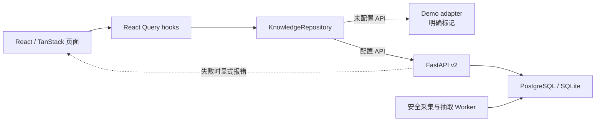
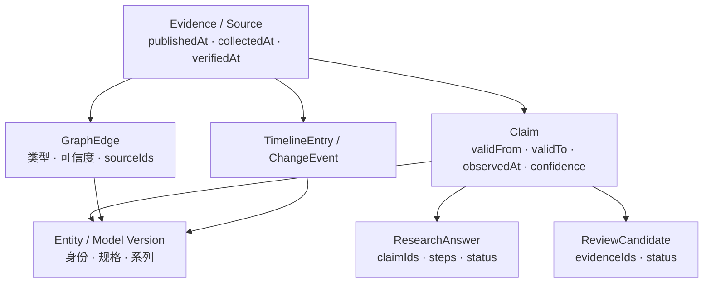
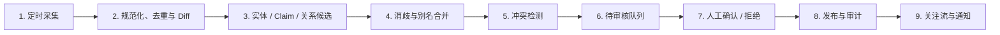

# AI Radar 架构与可信数据闭环

[产品案例](portfolio/CASE_STUDY.md)展示用户研究流程，[验证记录](portfolio/VALIDATION.md)区分已核对的行为与仍待验证的环节。

运行说明核对：2026-11-18。当前部署事实与配置证据统一见[部署核对记录](STAGING_DEPLOYMENT.md#当前部署核对记录)，历史 ADR 与评测不是运行配置来源。

## 系统边界

仓库同时交付 React/TanStack 前端、FastAPI API、SQLAlchemy/Alembic 数据层，以及明确标记的演示数据。前端可以无后端运行作品集模式；配置 `VITE_API_BASE_URL` 后会使用真实 API，失败时显示错误，不会静默退回演示数据。



## 前端分层

```text
src/
├─ domain/                       强类型契约、标签与图算法
├─ data/generated/snapshot.json 公共离线快照生成物，按需加载
├─ services/
│  ├─ knowledge-repository.ts    Demo / Live 数据边界
│  ├─ admin-api.ts               审核与目录维护 API
│  └─ user-api.ts                登录、关注、通知和研究
├─ hooks/use-knowledge.ts        查询状态与缓存语义
├─ components/
│  ├─ graph/                     SVG 关系查询工具
│  ├─ research/                  逐结论引用与导出
│  └─ pwa-status.tsx             安装、离线和缓存时间
└─ routes/                       文件路由和页面编排
```

## 前端数据生成边界

配置 API 时，目录通过 API 获取资料。`knowledge-repository.ts` 仅在未配置 API 的离线模式按需加载 `src/data/generated/snapshot.json`；目录请求失败不会静默切换为离线适配器。首页另以 `src/data/generated/home-overview.json` 首屏渲染，再核对已发布资料；同步失败保留已有首页内容并展示同步状态。这种首屏与缓存策略不代表后台请求已经成功，也不提供外部消息实时全量追踪。

`npm run generate:frontend-snapshot` 从种子基线、后端目录和扩展生成经过公共投影的快照，并校验 `product/core-models.v1.json` 的目录覆盖。清单用于校验，不缩减完整目录。生成物不是独立事实编辑入口；修改上游后重新生成。`npm run check:frontend-snapshot` 检查一致性，CI 另执行生成与 Git diff。

`demo-baseline.ts` 和 `src/lib/demo-data.ts` 保留历史种子及测试输入，正式客户端不导入它们。动态加载负责隔离离线数据，是否减包以实际构建结果为准。

## 后端分层

```text
backend/
├─ app/main.py             应用组装、中间件与路由注册
├─ app/api/                按领域拆分的端点、共享会话和鉴权依赖
├─ app/runtime.py          每个应用实例独立的服务组装
├─ app/services/           目录、抽取、审核、报告与诊断共享逻辑
├─ app/repository.py       正式目录、审核门禁与公共快照
├─ app/database.py         SQLAlchemy 持久化模型
├─ app/ingestion.py        URL 规范化、快照、哈希去重和 Diff
├─ app/extraction.py       结构化模型抽取适配器
├─ app/quality.py          数据验收与黄金问题
├─ app/engagement.py       关注、通知、摘要和研究
└─ migrations/             可复现的 Alembic 迁移
```

公共目录的 Entity、具体模型版本、关系和时间线存入数据库。首次启动会从版本控制内的种子初始化；管理员之后可通过受保护 API 或 `/admin/review` 增量维护。`familyId` 把具体版本归入顶层模型系列，新增版本不要求改前端。

## 知识与证据模型



关键约束：

- `valid time` 表示事实在现实世界何时有效，`observed time` 表示系统何时发现。
- 已核验关系和时间线必须带来源；没有证据时不能标为 `verified`。
- `verified`、`inferred`、`unverified`、`conflict` 使用文字、图标和线型共同表达。
- 自动采集和模型抽取只生成候选，不能绕过人审直接成为公共 Claim。
- 演示快照始终保留 Demo 标记；Live API 不可用时不伪装为实时数据。

## 数据生产与审核



`/admin/review-demo` 是只读作品集；`/admin/review` 使用 JWT/RBAC，支持审核、采集、摘要、Outbox 和目录扩展。管理员写入会进入审计日志。

## 关系图谱为何存在

图谱是关系查询工具，不是装饰性的 3D 场景：

- 节点表示实体或具体模型版本，边明确标注“属于系列、后继版本、由谁开发、使用什么、参与什么评测”等语义。
- 点击边可查看方向、有效时间、可信度和来源；点击节点可查看一跳/两跳邻域。
- 路径查询回答“两个对象如何发生联系”，时间筛选回答“这段关系在何时成立”。
- 颜色之外还使用形状、文字和线型；明暗主题均使用对应画布和高对比文本。
- 移动端提供列表替代视图。当前不提供 3D，因为 3D 不增加上述查询价值。

## PWA 与离线策略

Service Worker 缓存静态资产，不缓存应用导航 HTML、登录态、个人研究正文或 API 数据。断网导航返回独立离线说明页并保留原地址。已打开页面的查询缓存和首页初始快照另有状态提示，不能把它们的存在当作 API 当前可用。

## 部署结构

- 本地开发：SQLite + Vite + Uvicorn。文档统一使用前端 8082、API 8001；数据库是独立本机文件，不同步云端账户和研究。
- 在线预发布：Cloudflare Workers 前端 + Render Free FastAPI + Supabase PostgreSQL。2026-11-18 已在现有 Render 配置核对 Supabase 连接池、5432 端口及 TLS 要求；完整连接串只保存在部署环境。
- 调度配置：Cloudflare Cron 每 5 分钟直连轻量 `/health` 保活，每 30 分钟调用受保护的单周期接口。保活不访问数据库、不执行采集或模型调用；GitHub Actions 保留 `workflow_dispatch` 手动直连同一 PostgreSQL 的应急入口。仓库配置与持续成功执行日志分别核对。
- Docker 容器启动前执行 `alembic upgrade head`。
- CI 同时验证 SQLite 与 PostgreSQL 迁移、前端构建、后端测试和种子同步。
- 线上保持 `AI_RADAR_DATA_MODE=demo`，只有正式数据质量门槛通过后才允许切换 `live`。
- 自定义域名 `airadar.rainza.cn` 已提供 HTTPS 访问。邮件选择 Resend，但当前缺少投递密钥与发件人；摘要保留在 Outbox。外部监控、恢复演练与真实收件箱送达仍需各自的验证记录。
- 候选抽取已配置 SoleAPI；普通自动抽取上限为 0。模型需求解析是另一套账号与预算配置，目前关闭。检索配置为 Cloudflare hybrid；当前请求实际使用的模式与降级原因以请求诊断为准。

## 关键技术决策

- 公共读取与审核写入分离：公开接口只组合种子和已批准记录，待审、驳回与证据不足内容不会泄漏到公共快照。
- 自动化采用有限吞吐：每周期最多处理有限信源和快照，失败进入退避与冷却，避免供应商故障放大成本。
- 当前自动抽取只生成候选，所有关系和普通事实均进入人审；是否开放任何自动批准必须另行授权并由真实精度证明，不以数据增长速度换取可信度。
- Cloudflare Cron 使用独立自动化令牌、有限重试、结构化生命周期日志和数据库租约；GitHub 手动应急任务使用仓库级 `AI_RADAR_DATABASE_URL` Secret，并须指向预期环境。运维诊断只记录信源 ID，不把 URL 参数、错误正文或凭据写入外部日志。
- 图谱保持二维并提供列表替代视图，因为查询方向、路径、时间与证据比视觉炫技更重要。
